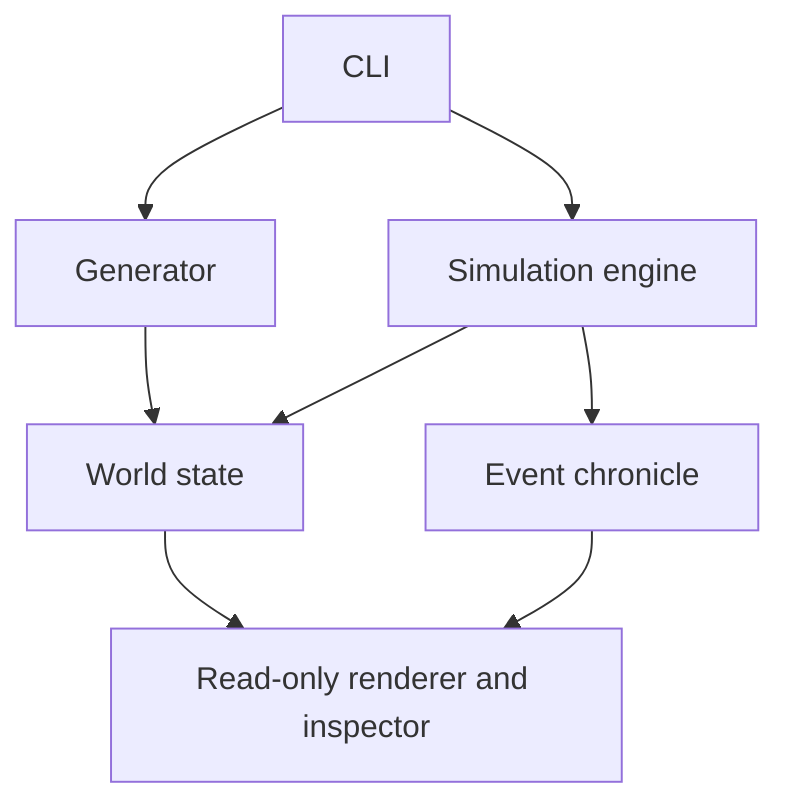

# World Weaver — Design Document

Status: Revised conceptual baseline / living document. Numerical formulas and implementation choices remain provisional unless stated otherwise.

## 1. Vision and scope

Generate a fantasy ecosystem, advance time, and observe the history that emerges from autonomous populations interacting with their environment and each other. The initial experience is an observer sandbox, not a character-controlled game. No victory condition is required.

The first MVP demonstrates renewable vegetation, prey, multiple tribes, shared food reserves, hunting expeditions and resource competition on a seeded map. The broader core adds dynamic influence, governance, encounters, diplomacy, fragmentation and autonomous predator packs. Individual inhabitants, advanced economies, magic and kingdoms are deferred.

## 2. Design principles

- Influence is not ownership; overlap creates opportunities for interaction, not automatic hostility.
- Needs influence intentions; intentions influence actions; actions have uncertain consequences.
- Leadership biases decisions but does not guarantee compliance or success.
- Dissatisfaction affects behavior; confidence buffers political change.
- Expansion is a strategy, not a measure of success.
- History emerges from rules and is recorded as events.
- Prefer aggregate models, pure calculations, composition and explicit state. Extract shared abstractions after concrete implementations demonstrate a need.

## 3. Architecture



The world model does not print or read input. The simulation engine owns state changes. Evaluation functions return values without mutation or random draws. The observer reads state and events. Start sequentially; use stable ordering and seeded randomness. Introduce concurrency only after measuring a need, preferably across independent experimental runs first.

Initial layout (proposed, not mandatory):

```text
world-weaver/
  README.md
  docs/DESIGN.md
  docs/ROADMAP.md
  go.mod
  cmd/world-weaver/main.go
  internal/world/world.go
  internal/world/world_test.go
```

Add packages for generation, ecology, simulation, collectives, rendering and history as responsibilities become substantial. Do not create empty packages merely to match a future architecture.

## 4. World and ecological layers

A finite, non-wrapping rectangular grid is the initial model. Proposed starting dimensions: 40 x 25, configurable. Coordinates identify tiles; tiles represent abstract regions, not fixed physical distances. Initial terrain: grassland/plains, forest, mountain, water and barren land. Terrain determines movement cost, resource capacity and suitability for inhabitants.

| Layer | State and behavior |
|---|---|
| Terrain | Stable geographic classification; later elevation and moisture |
| Vegetation | Renewable biomass with terrain-dependent capacity and growth |
| Prey | Aggregate counts by species or category per tile; consume vegetation, reproduce, die and later disperse |
| Predators | Initially aggregate populations or deferred until autonomous packs; consume prey |
| Collectives | Stable IDs, population, home, needs, range, actions and history |

Grasslands are terrain supporting vegetation, not agents with leadership. Prey may later form mobile herds with collective needs and movement, without requiring elections or human politics. Predator packs share geographic and resource mechanisms with tribes but use species-appropriate social rules. Avoid counting the same animals both in aggregate tile populations and in mobile groups.

Resource transfers must be explicit. Vegetation regeneration and births are sources; consumption and mortality are sinks. Clamp stocks and counts to valid bounds. When prey is harvested, reduce its population and credit food according to a defined conversion; no duplicate harvests. Initial reproduction, consumption and starvation formulas should be simple and testable.

## 5. Autonomous collectives

A collective is a conceptual grouping of inhabitants acting together. Start with concrete tribe types and aggregate populations; later extract shared components when packs or herds require them.

| Concept | Responsibility |
|---|---|
| Identity | Stable ID, name, ancestry and history |
| Population | Member count, hunger/health aggregates, growth and mortality |
| Home | Primary settlement or den; initially one per collective |
| Resources | Food stockpile for tribes; species-specific feeding for animals |
| Range of influence | Reachable area in which activities may occur |
| Leadership | Traits and decision biases where applicable |
| Confidence and cohesion | Trust in leadership and attachment to the group, respectively |
| Expedition | Participants, objective, destination, progress and outcome |
| Relationships | Pairwise history, tolerance, hostility or cooperation |

Population needs drive pressures. Leadership selects intentions through weighted preferences rather than rigid personality rules. An aggressive leader may still negotiate when circumstances favor it. Members may execute orders imperfectly. No individual movement or combat simulation is necessary initially.

## 6. Geography and range of influence

Home is the center of activity. Range of influence is the area a collective is willing and able to operate in; it is not a political border or exclusive ownership. Multiple ranges may overlap. Claimed territory, if introduced later, is a separate concept.

Start with a fixed travel-step budget and orthogonal movement; use breadth-first search to find reachable tiles. Later use terrain-dependent costs and Dijkstra's algorithm for reachable areas, and optionally A* for destination routing. Water may be impassable initially. A route must be feasible for the expedition's return as well as outward travel.

Dynamic ranges gradually adjust toward a desired budget. Food scarcity, declining hunting returns, population growth and exploration preferences can encourage expansion. Abundance, travel cost, danger and casualties can encourage contraction. A rolling history of yields should distinguish persistent scarcity from one unlucky hunt. Normalize yields by effort or party size when practical. The precise adjustment rate and bounds are balancing decisions.

The terminal observer should distinguish home markers, influence overlays, overlapping regions and active expeditions. Initially a tile is inside or outside each collective's range; graded influence and directional preferences are optional later features. Full knowledge of reachable tiles is a proposed simplification; discovery and stale memories are deferred.

## 7. Expeditions and encounters

Expeditions are temporary groups with a destination and purpose. Begin with hunting; later reuse the lifecycle for exploration, gathering, diplomacy, migration and conflict. A proposed lifecycle is assigned, traveling, performing activity, returning, completed or lost. Members away from home remain part of the population but cannot be assigned twice. Return food to the home stockpile only on arrival; account for casualties and lost cargo explicitly.

Destination desirability balances expected reward, travel effort, danger and collective needs. Scarcity can make risky destinations worthwhile without an explicit command to invade. Include the option to stay home when no feasible expedition exists.

Overlapping ranges create resource competition even without encounters. Actual encounters require compatible presence in the same place/time (or an explicitly documented aggregate approximation). Encounters may result in avoidance, tolerance, cooperation or conflict. Danger depends on the groups and their relationships, not merely on overlap. Distinguish indirect competition, incidental conflict and intentional attacks. Allied groups may share access; hostility can discourage use of contested areas.

## 8. Governance and social dynamics

### 8.1 Pure dissatisfaction evaluation

Population pressures describe current hardship: hunger, insecurity, crowding, war exhaustion and other unmet needs. Leadership traits (proposed: aggression, cooperation, ambition, risk tolerance, stewardship) bias decisions. A single deterministic, read-only evaluation calculates dissatisfaction from pressures and traits. It must not modify world state, leader, population, confidence or RNG. Severe hardship should matter even when traits align well with needs.

Use the same function for incumbent evaluation and candidate comparison. The score is not itself a calibrated probability of overthrow.

### 8.2 Compliance and confidence

Dissatisfaction affects actual behavior: reduced participation, productivity, refusal or unauthorized actions. Initially represent these through bounded aggregate adjustments rather than individual decisions. Avoid making all survival work impossible at high dissatisfaction; distinguish voluntary resistance from physical inability.

Leadership confidence is persistent goodwill/patience associated with the current leader. Dissatisfaction determines the magnitude of confidence loss during adverse ticks; favorable conditions gradually restore confidence. A new leader starts with moderate renewed confidence, not maximum confidence. Material conditions never reset. Improving trends may later influence recovery if needed to avoid repeated succession during inherited crises.

Confidence protects against overthrow, but zero confidence does not guarantee it. A separate instability evaluation combines dissatisfaction and confidence; political action is resolved by the engine. Exact thresholds, probabilities, recovery rates and initial confidence remain open. A per-tick probability must be calibrated to the tick duration. High dissatisfaction with high confidence can produce resistance without overthrow; low confidence with improving conditions permits recovery.

### 8.3 Succession

When an overthrow or vacancy occurs, generate three candidates with seeded random traits. Evaluate each against the same immutable population-pressure snapshot using the ordinary dissatisfaction function. Elect the lowest-scoring candidate; seeded tie-breaking is proposed. Restore moderate confidence and preserve population, hunger, food, home, range, relationships, expeditions and history. Record candidates, scores and result. The best available candidate is not guaranteed to succeed. The timing of new orders relative to succession is still open.

### 8.4 Cohesion and fragmentation

Cohesion represents attachment to the group, distinct from confidence in leadership. Severe dissatisfaction can lead to continued resistance, replacement of leadership, abandonment or fragmentation. Population size, cohesion and viable destinations influence which outcomes are possible. Splitting is not automatically a 50/50 division.

A split partitions members and resources without duplication. Each resulting group resolves leadership; one may retain the home while another migrates, or both may contest the same home temporarily. Preserve ancestry and establish a relationship between successors. Account for outstanding expeditions and resource cargo before partitioning. Minimum viable group size, resource division, identity inheritance and leadership retention rules remain open. Joining/merging groups is a later extension with the same conservation requirements.

### 8.5 Animal groups

Predator packs can use hunger, hunting range, risk, movement, cohesion and fragmentation mechanisms. Their leadership changes and group formation need not resemble human elections. Wild wolf packs are generally family groups; the simulation should not require an artificial alpha-election model. Prey herds can later use movement, feeding and dispersal without political mechanics.

## 9. Simulation time and determinism

Proposed initial tick: one day. Begin with sequential phases and explicit rules for simultaneous claims. As systems interact, use read-only snapshots to gather intentions before resolving contested actions. A possible order (subject to testing):

```text
advance clock
regenerate vegetation and update ecological needs
capture decision snapshot
calculate pressures, dissatisfaction and confidence changes
resolve political events and collect feasible intentions
resolve movement, encounters and resource acquisition
apply consumption, births, deaths and other consequences
record significant events; expose state to observer
```

Specify exact phase order when implementing each milestone; do not apply consumption twice. Use stable IDs, deterministic iteration and explicit tie-breaking. Shared resource allocation must not depend on arbitrary Go map iteration; document a deterministic allocation rule and test it. Seeded runs with identical configuration and simulation version should reproduce results. Evaluation and rendering must not consume simulation randomness.

## 10. Observation and history

Terminal-first: render terrain, homes, ranges and expeditions; inspect tile resources, population needs, leader traits, dissatisfaction, confidence and relationships as they become available. Structured events contain tick, type, affected IDs, location and relevant before/after values. Record meaningful transitions rather than repeating unchanged conditions every day. Later connect events through causal references where supported, without inventing causes.

Future experiment mode runs multiple seeds or controlled scenarios, compares survival, population, resources and political outcomes, and reports variation. Compare strategies under equivalent starting conditions; results describe programmed rules, not real-world sociology. Persistence must eventually save enough state, including randomness, to continue reproducibly.

## 11. Testing and scope controls

Use table-driven Go tests, small hand-authored scenarios and invariants: map bounds, reachability, deterministic generation, nonnegative resources, no double allocation of members or prey, pure evaluations, bounded confidence, candidate selection, overlap without automatic combat, split conservation and stable replay. Add benchmarks before optimization.

Deferred: individual NPCs and animals, genetics, equipment, tactical combat, magic, religion, technology trees, detailed trade, multi-settlement kingdoms, exclusive borders, advanced UI and procedural languages. Do not add these as prerequisites for core milestones.

Open implementation decisions: exact terrain generation, ecological rates, food units, tick order, movement budgets, confidence and instability formulas, compliance effects, cohesion and split rules, species-specific behaviors, save format, license and UI library. These are deliberately not settled by illustrative prototypes.
