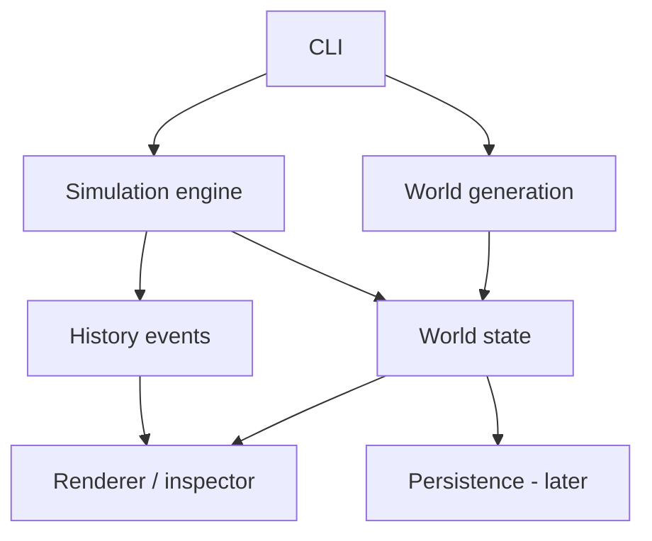

# World Weaver — Design Document

Status: Draft / living document

## 1. Vision

Generate a fantasy world, advance its clock, and observe the history that emerges from interactions between geography, resources, civilization, and autonomous agents. The initial experience is that of an observer rather than a player controlling a character. Tabletop RPGs inspire the setting; implementing official D&D mechanics is not an initial requirement.

## 2. Scope

The first meaningful prototype generates a small seeded map, places settlements, and advances a simple food economy over multiple days while recording significant events. Individual inhabitants, warfare, magic, and detailed politics are later extensions, not prerequisites.

## 3. Design principles

- Separate generation (initial conditions), simulation (changes over time), and presentation (observation).
- Keep state explicit and rules independently testable.
- Use seeded random sources and stable iteration order where reproducibility matters.
- Prefer aggregate population models before simulating every individual.
- Start sequentially; benchmark before introducing concurrency.
- Prefer small cohesive packages, concrete types, and composition. Introduce interfaces when consumers need interchangeable behavior.

## 4. Conceptual architecture



The CLI coordinates operations. The world model does not read keyboard input or print output. Simulation systems operate on world state; presentation reads it. Persistence is optional until the core model stabilizes.

## 5. Initial repository layout

```text
world-weaver/
├── README.md
├── docs/
│   ├── DESIGN.md
│   └── ROADMAP.md
├── go.mod
├── cmd/
│   └── world-weaver/
│       └── main.go
└── internal/
    └── world/
        ├── world.go
        └── world_test.go
```

This is a proposed starting layout, not a requirement to create empty packages. Add generation, simulation, rendering, history, and persistence packages only as responsibilities become substantial. Keep tests beside the code they exercise.

## 6. Conceptual data model

| Concept | Responsibility | Introduce |
|---|---|---|
| Coordinate | Identify a tile by x and y | M1 |
| Terrain | Classify a tile independently of its glyph | M1 |
| Tile | Hold terrain and later geographic attributes | M1 |
| World | Own map dimensions, tiles, seed, and later simulation state | M1–M2 |
| Settlement | Stable ID, name, location, population, resources | M4 |
| Clock | Track elapsed simulation days | M5 |
| Event | Record day, event type, affected IDs, and relevant facts | M5–M6 |
| Faction / Agent | Ownership, relationships, goals and decisions | Later |

These are conceptual responsibilities, not prescribed Go structs. Decide how to represent coordinates, tiles, and grid storage during M1. A rectangular grid is the proposed default; x increases rightward and y downward.

## 7. Generation pipeline

1. Initialize a local seeded random source.
2. Generate elevation and classify land and water.
3. Add temperature and moisture layers.
4. Derive biomes from geographic conditions.
5. Add waterways when a suitable drainage model is ready.
6. Score candidate settlement locations and place settlements with minimum spacing.
7. Connect settlements with roads and trade routes later.

Begin with simple random terrain as a learning exercise, then investigate coherent noise (value noise, Perlin or Simplex noise). Keep generation separate from display. Test bounds, valid terrain, seed reproducibility and settlement placement invariants. The same seed and configuration should reproduce the same world within the same generator version.

## 8. Simulation loop

Proposed initial tick: one day. Begin with a single sequential update.

```text
advance one day
calculate production
calculate consumption and shortages
collect decisions (when agents exist)
resolve actions
update state
record significant events
```

As interacting systems grow, consider a snapshot/intent/resolution approach to prevent results depending on arbitrary iteration order. Use stable IDs and explicitly defined tie-breaking rules. Do not rely on Go map iteration order for deterministic behavior.

### First economic model

A settlement produces food and consumes food according to population. Stored food cannot become negative. Track unmet demand separately. Record shortage onset and recovery rather than emitting identical events every day. Initially, population may remain fixed; migration, mortality and growth can be introduced after the resource model is tested.

### History

Events should be structured records, not just strings. Render readable chronicle entries from recorded facts. Later, event references can connect consequences to earlier causes.

## 9. Testing strategy

Use Go's testing package and table-driven tests. Test map bounds, rendering, generation reproducibility, placement rules, clock progression, resource conservation, and shortage behavior. Run `go test ./...` before merging. Use benchmarks when performance becomes a real concern.

## 10. Open decisions

- Flat slice versus nested slices for map storage.
- Map dimensions and topology beyond the initial rectangular grid.
- Terrain generation algorithm and whether to implement noise or use a library.
- Simulation scale, time units beyond days, and population granularity.
- Fantasy species, magic, monsters, and degree of tabletop rules compatibility.
- Terminal UI library, save format, and license.

Record significant decisions here as implementation proceeds. No external dependency, concurrency model, or detailed D&D ruleset is mandated by this draft.
